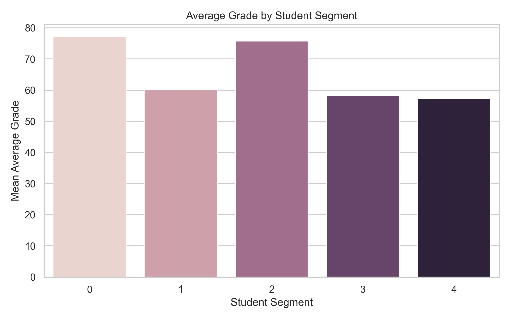
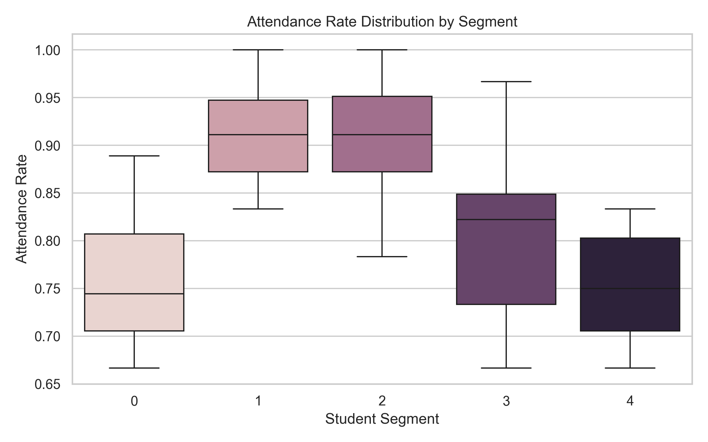

# Student Engagement Segment Profile Report

## 1. Introduction

This report summarizes the characteristics of student segments
created using K-Means clustering. The analysis uses attendance
rate, average grade, and the segment labels in the dataset.

The dataset contains **300 student records** across
**5 segments**.

## 2. Segment Summary

The table below shows the number of students in each segment,
their mean attendance rate, and their mean average grade.

| Segment | Student Count | Mean Attendance Rate | Mean Average Grade |
| --- | --- | --- | --- |
| 0 | 60 | 0.754 | 77.21 |
| 1 | 79 | 0.913 | 60.23 |
| 2 | 56 | 0.908 | 75.75 |
| 3 | 46 | 0.806 | 58.38 |
| 4 | 59 | 0.751 | 57.36 |

**Note:** The attendance rate is reported on the same scale as
the input dataset. If it is stored between 0 and 1, a value of
0.85 represents 85% attendance.

## 3. Average Grade by Segment

The bar chart compares the mean average grade across segments.

## 4. Attendance Distribution by Segment

The box plot shows the distribution of attendance rates in each
segment. The median, spread, and potential outliers illustrate
how attendance varies within each group.

## 5. Interpretation

Use the table and charts together to compare the segments.
A higher mean grade or attendance rate describes the observed
dataset; it does not prove that a segment is inherently better
or that one factor caused another.

Segment numbers are identifiers, not performance rankings.

## 6. Limitations

The dataset may be synthetic, and the profiles have not been
validated against real student outcomes. These findings are
exploratory and should not be used to make decisions about real
students without further validation.

## 7. Generated Files

- `segment_grade.png` — average grade by segment.
- `segment_attendance.png` — attendance distribution by segment.
- `segment_profile_report.md` — this report.
